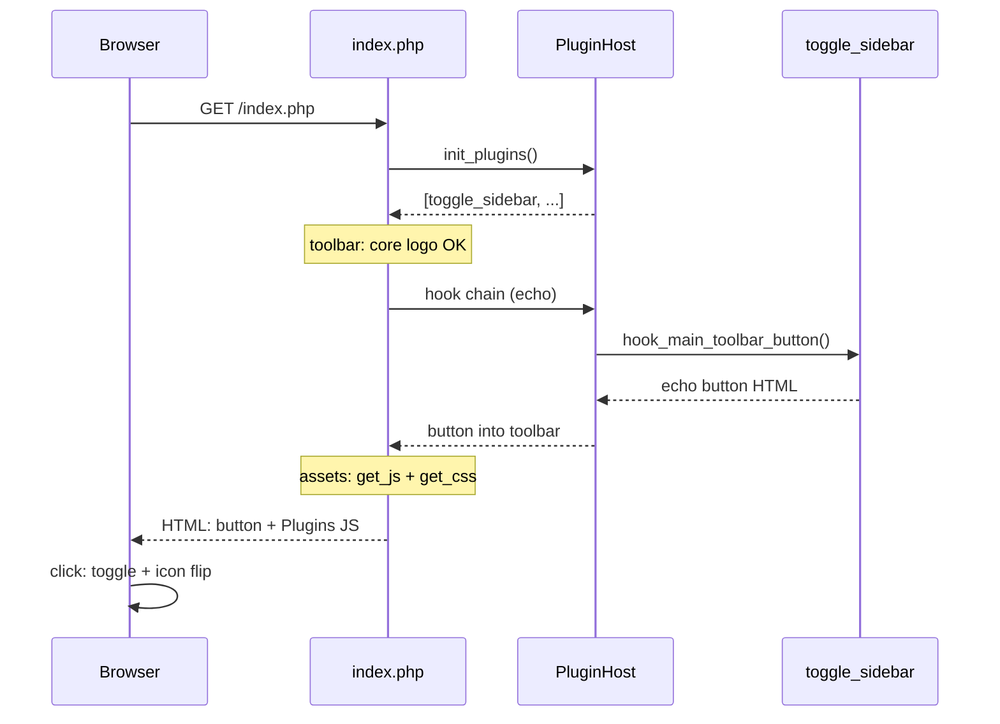
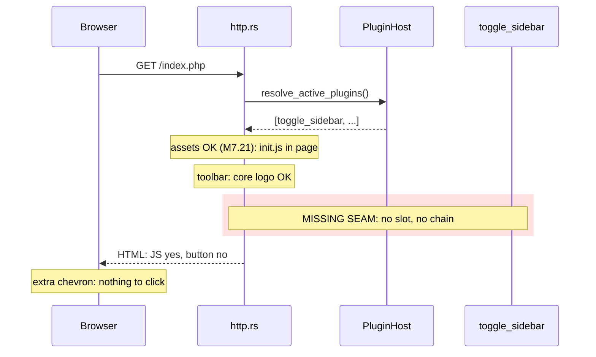
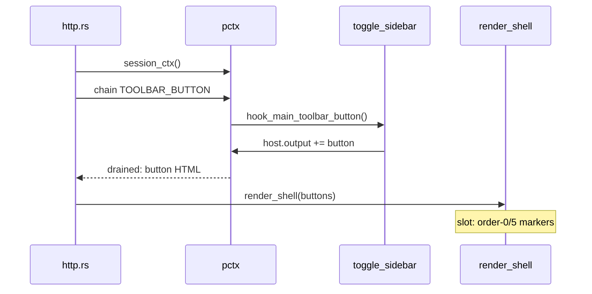

# M7.22 — Unwired hook call sites (audit record, 2026-09-22)

Companion to the M7.21 close-out commit (`c2c8057`). This document records the
state of the world after the M7.21 hook audit: what is missing, why the green
suite didn't catch it, and the proposed work breakdown.

## Progress

- **2026-09-23 — item 1 done: `HOOK_MAIN_TOOLBAR_BUTTON` wired.** The shell's
  `{{ main_toolbar_buttons }}` slot (between the order-0/order-5 toolbar
  markers) is fed by a plain `run_hooks` chain — PHP's
  `run_hooks_callback(HOOK_MAIN_TOOLBAR_BUTTON, echo)` echo callback only
  prints and never short-circuits — over a per-request `session_ctx` host
  (`http.rs::main_toolbar_buttons`). Tests: render-level
  (`render::tests::shell_renders_main_toolbar_buttons_between_markers`) and
  router-level with a real session + DB
  (`tests/toggle_sidebar_plugin.rs`: button present when the plugin is active
  at system level, slot empty when inactive). E2E matrix verified against the
  demo server: (A) absent when the plugin is nowhere enabled; (B) per-user
  enablement via `_ENABLED_PLUGINS` shows the button for exactly that user —
  another logged-in user's shell stays button-free; (C) the system-level case
  is the router test. Items 2–9 remain outstanding (item 9 was filed the
  same day — see the Effort list).

## The shape of the problem

M7 ported **18 plugins** (the hook *implementations*) but the **call sites**
(where the core fires the hook chains) only partially landed. The plan's own
rule was "call sites land *with* the plugin that needs them" — for several
plugins, the plugin landed and the call site didn't. Concretely:

### A. Hooks PHP fires that the port never dispatches (7 sites, stock implementers included)

| Hook | Where in PHP | Who implements it | What's dead in the port |
|---|---|---|---|
| ~~`HOOK_MAIN_TOOLBAR_BUTTON`~~ ✅ 2026-09-23 | `index.php:195` (shell toolbar) | toggle_sidebar | the sidebar-toggle button doesn't exist in the UI at all (wired — see Progress) |
| `HOOK_HOTKEY_MAP` | `RPC::get_hotkeys_map` | hotkeys_swap_jk, hotkeys_noscroll | both vim-orientation plugins are dead code — j/k swap never reaches the client |
| `HOOK_PREFS_TAB` ×5 + `HOOK_PREFS_TAB_SECTION` ×5 | 10 sites across the 6 `Pref_*::index` PHP templates | af_comics, af_psql_trgm, bookmarklets, nsfw, share | none of those plugins' prefs panes appear on the port's prefs tabs |
| `HOOK_ARTICLE_IMAGE` | `Article.php:571` (`_get_image`) | nsfw | the NSFW placeholder image is never applied |
| `HOOK_RENDER_ARTICLE` | inside the **share plugin's** public `get` route | nsfw | a shared article page (no-account visitor) doesn't get NSFW wrapping |
| `HOOK_FEED_BASIC_INFO`/`_FETCH_FEED`/`_SUBSCRIBE_FEED` | `RSSUtils` parse/fetch, `Feeds::_subscribe` | af_comics | comic-strip repair never runs at fetch/subscribe time (already NOTEd "M8") |

### B. Two sites where the port *hardcodes* stock-plugin output instead of dispatching

- `article_buttons()` (`headlines.rs:845`) — the note/share/trgm icons are
  literal HTML gated on plugin *names*, not the result of the
  `HOOK_ARTICLE_BUTTON` chain.
- `format_enclosures()` (`headlines.rs`) — the YouTube player is literal
  HTML, not `HOOK_RENDER_ENCLOSURE` (and `HOOK_ENCLOSURE_ENTRY` — whose only
  stock consumer, `cache_starred_images`, rewrites enclosure URLs to local
  cache copies — never fires).

Group B is behaviorally equivalent *for the stock set* today, but the plugins'
hook methods are dead code, and — the structural reason it matters — the
plan's locked WASM-swap decision promises "a later loader change touches no
hook call site." Hardcoded sites break that promise: a WASM (or any future)
plugin implementing these hooks would silently do nothing.

## Why the suite is green with all this missing

The plugin hook *bodies* are unit/DB-tested in isolation (called directly
with a test host), and the hardcoded core paths are tested through their
output. Nobody tests the **composition** — core fires chain → plugin
transforms → output. That's exactly the seam that's broken.

## Effort, bottom-up (each an independent increment with tests)

1. **Main toolbar button** — small: a shell-template slot + render param,
   same pattern as the asset slots (M7.21).
2. **Hotkey map** — small: make `hotkeys_map()` host-aware, run the chain at
   the init-params site, recompute prefixes *after* the hooks (PHP order
   matters — plugins can add keys).
3. **share public-`get` render hook** — tiny: one chain inside share.rs.
4. **`get_image` image hook** — small: add the chain to
   `article::get_image`, delete the stale NOTE.
5. **De-hardcode article buttons** — small-medium: replace the hardcoded row
   with the chain; byte-parity test against today's output (the plugins
   already produce it, so the test pins equivalence).
6. **De-hardcode enclosures** — small-medium: two chains (`RENDER_ENCLOSURE`
   per-enclosure HTML override, `ENCLOSURE_ENTRY` array rewrite) +
   byte-parity test.
7. **Prefs-tab hooks** — the big one: 6 Rust tab handlers × 10 PHP sites,
   with `HostCtx.output` collection and *positions that matter*
   (`prefPrefsPrefsInside` vs `_Outside` are inside/outside the accordion
   container). This is a real increment, not a one-liner.
8. **af_comics fetch hooks** — medium, and the plan already parks it at M8;
   leave it there.
9. **Empty-active-set chains in `feeds.rs`** (found 2026-09-23, verified
   same day) — *wired but dead in a different way*: the
   `HOOK_PREFS_EDIT_FEED` (`feeds.rs:2821`) and `HOOK_PREFS_SAVE_FEED`
   (`feeds.rs:1749`) chains build their `HostCtx::for_user` with `&[], &[]`
   (empty system **and** user plugin lists), so `run_hooks` iterates over
   zero active plugins. Sole stock implementer: `af_psql_trgm` — its
   per-feed enable/disable is both unrendered (`plugin_data` is always
   empty) and unsaved. Fix: swap each for `dispatch::session_ctx(state,
   &sess)` (the canonical active-set builder — same as item 1's toolbar
   chain) + a regression test that the af_psql_trgm checkbox appears in the
   feed-edit payload when the plugin is active. Small.

Realistically: items 1–6 + 9 are a day or two of small verified blocks; 7 is
its own increment; 8 waits for M8. After each wiring, the affected feature
(sidebar button, j/k swap, NSFW placeholder, share page, bookmarklets prefs
pane…) is actually *live* — which is what the M7 exit criterion ("the stock
set reproduces the PHP UI features it drives") currently claims but doesn't
hold.

## Recommendation

Do 1–6 now as a sequence of small commits (each demo-able), then 7, then park
8.

## Sequence diagrams (mermaid)

Item 1 (`HOOK_MAIN_TOOLBAR_BUTTON` / toggle_sidebar), end to end. The
client-side half (click → `App.toggleSidebar()` + icon flip) is identical in
both; only the server-side button emission differs.

Diagrams are kept ≤100 columns wide: pi's terminal renderer (`grok-mermaid`)
silently falls back to raw text when the rendered diagram exceeds the
available terminal width, and does not interpret ` ` in note labels (it
prints them literally).

**Reference (PHP, `toggle_sidebar` enabled):**

**The port today — one seam cut (red block = the missing piece):**

**The fix (item 1):**

Client side needs nothing new: `Plugins.Toggle_Sidebar.toggle` already
arrives with the JS (M7.21); once the element exists, the click works.

## Verification facts gathered during the audit (for the implementer)

- Reference stock set == ported set for every audited hook (grepped
  `tt-rss/plugins/*/init.php` vs `crates/ttrss/src/plugins/`).
- Bare `HOOK_RENDER_ARTICLE` is dispatched **nowhere in PHP's core** — only by
  the share plugin's own public `get` route (`tt-rss/plugins/share/init.php:149`).
  So the non-cdm/nsfw render-hook divergence is confined to that one site.
  (`_CDM`/`_API` variants are wired: `headlines.rs:762`, `api.rs:1089`.)
- PHP `HOOK_HOTKEY_MAP` fires **before** prefixes are computed
  (`tt-rss/classes/RPC.php:629`); the port's static table
  (`crates/ttrss/src/hotkeys.rs:76`, called from `rpc.rs:858`) has no chain.
- `cache_starred_images::hook_enclosure_entry` rewrites
  `enc["content_url"]` to the local DiskCache URL when a cached copy exists
  (`tt-rss/plugins/cache_starred_images/init.php:118`).
- `article::get_image` exists at `crates/ttrss/src/article.rs:321` (the
  ported `Article::_get_image`); its NOTE ("hook omitted, no plugins") is
  stale — nsfw implements `hook_article_image`.
- Prefs-tab PHP fire sites (tab argument in quotes):
  `Pref_Feeds.php:1011` `prefFeedsOPML` (SECTION), `:1031`
  `prefFeedsPublishedGenerated` (SECTION), `:1055` `prefFeeds` (TAB);
  `Pref_Filters.php:808` `prefFilters` (TAB); `Pref_Labels.php:213`
  `prefLabels` (TAB); `Pref_Prefs.php:764` `prefPrefsPrefsInside` (SECTION),
  `:787` `prefPrefsPrefsOutside` (SECTION), `:944` `prefPrefs` (TAB);
  `Pref_System.php:265` `prefSystem` (TAB); `Pref_Users.php:226`
  `prefUsersToolbar` (SECTION).
  Port tab handlers: `Pref_Feeds::index` (`feeds::index`),
  `Pref_Labels::index` (`labels::index`), `Pref_Filters::index`
  (`filters::index`), `Pref_Prefs::index` (`pref_ui::index`), plus
  `Pref_System`/`Pref_Users` — each pane lazy-loads via
  `backend.php?op=Pref_<Name>` (`templates/prefs.html` TabContainer).
- `HOOK_SEARCH` fallback: closed separately (no reference plugin implements
  `hook_search` — exact and permanent; see plan.md M7.21 close-out).
